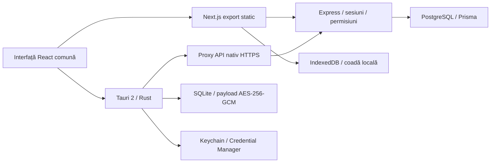

# Arhitectura implementată

Web și desktop folosesc aceeași interfață; runtime-ul alege transportul și persistența. Browserul folosește cookie HttpOnly. Desktopul injectează tokenul din seiful OS exclusiv în Rust, către API-ul fixat la compilare. PostgreSQL nu este accesat direct din desktop.

O operațiune de factură are UUID și versiunea documentului de bază. Persistența locală precede trimiterea; serverul aplică schimbarea, jurnalul și auditul în aceeași tranzacție. Reîncercarea aceluiași UUID/payload nu dublează efectul. Versiunea divergentă produce 409; alegerea explicită a utilizatorului este necesară. Rezolvarea prin versiunea locală produce o operațiune nouă.

API-ul folosește compania sesiunii, nu un identificator de companie furnizat pentru autorizare de client. Blocări tranzacționale coordonează emiterea, încasarea și închiderea perioadelor. Trigger-ele PostgreSQL protejează auditul, regulile aprobate și articolele postate împotriva modificării obișnuite. Un administrator al bazei are în continuare puterea tehnică de a altera schema; acestea nu reprezintă un registru extern inviolabil.

Regulile sunt date declarative versionate, cu interval și aprobare. Nu executăm formule JavaScript din configurație. Jurnalul reține ID-ul și versiunea regulii; aprobarea unei versiuni noi nu recalculează istoricul. Cele trei conturi și formulele inițiale sunt demonstrative și nu reprezintă un plan național consolidat.

## Persistență și limite

- SQLite desktop conține snapshot-ul criptat; cheia rămâne în stocarea OS. Copierea doar a bazei pe alt calculator nu constituie backup portabil utilizabil.
- Demo păstrează documentele proprii și configurația locală; API cache reține maximum 200 facturi și operațiunile în așteptare.
- Coada este pentru facturi/încasări. Operațiunile administrative API solicită conexiune.
- Web IndexedDB nu are criptare echivalentă cu seiful OS; nu salvează parola sau tokenul de sesiune în localStorage/IndexedDB. Protecția dispozitivului/browserului rămâne necesară.
- O instanță nativă și un tab web activ evită scrieri concurente în același snapshot.
- Backup/restaurare din interfață și migrarea completă de business sunt lucrări restante, nu funcții ascunse disponibile.
