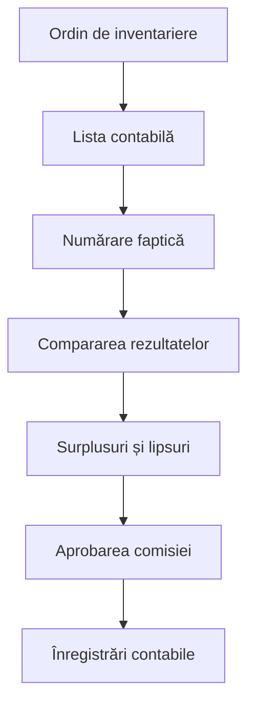
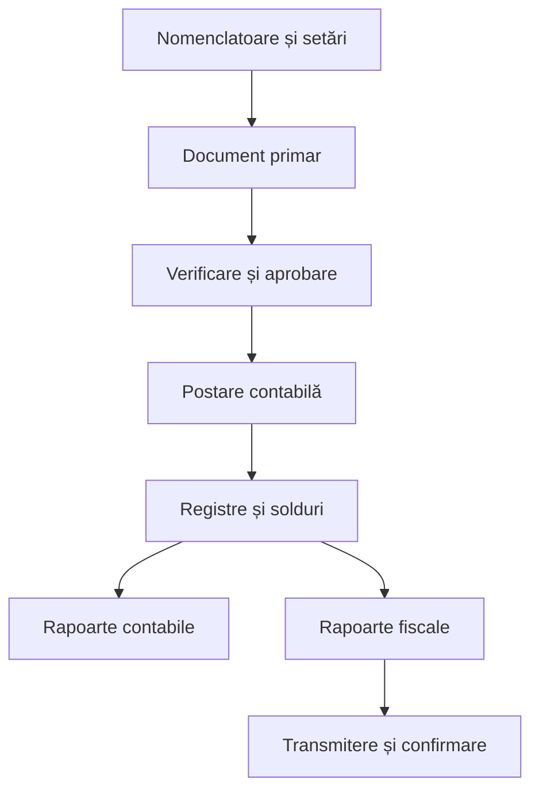

# Specificație integrală adoptată — 20 septembrie 2026

Referință furnizată de utilizator; produsul implementat este Socot, cu identitate originală. Lista de mai jos reprezintă cerințe, nu funcții declarate finalizate.

Programul 1C pentru contabilitatea unei întreprinderi trebuie să conțină toate instrumentele necesare pentru înregistrarea documentelor, formarea automată a formulelor contabile, evidența stocurilor, calcularea salariilor și generarea rapoartelor.

## 1. Ce trebuie să conțină programul 1C

### Întreprinderea

Aici se configurează:

- denumirea companiei;
- IDNO și codul TVA;
- adresa juridică;
- conturile bancare;
- directorul și contabilul-șef;
- subdiviziunile;
- depozitele;
- casieriile;
- politica contabilă;
- moneda de bază;
- regimul fiscal;
- perioada contabilă;
- utilizatorii și drepturile lor;
- soldurile inițiale.

### Nomenclatoarele

Acestea sunt listele folosite în toate documentele:

- planul de conturi;
- clienți și furnizori;
- contracte;
- produse și servicii;
- materiale;
- unități de măsură;
- cote TVA;
- valute;
- cursuri valutare;
- depozite;
- conturi bancare;
- casierii;
- angajați;
- funcții;
- mijloace fixe;
- articole de venituri și cheltuieli.

Informația se introduce o singură dată, după care este selectată în documente.

## 2. Modulul Cumpărări

Trebuie să includă:

- factura furnizorului;
- factura fiscală;
- recepția mărfurilor și materialelor;
- achiziția serviciilor;
- cheltuielile suplimentare de achiziție;
- importul;
- avansul acordat furnizorului;
- returul către furnizor;
- actul de reconciliere;
- registrul cumpărărilor;
- datoriile către furnizori.

### Cum lucrează

Exemplu: firma cumpără materiale.

1. Contabilul creează documentul „Recepție”.
2. Selectează furnizorul și contractul.
3. Introduce factura, produsele, cantitatea, prețul și TVA-ul.
4. Selectează depozitul.
5. Salvează și verifică documentul.
6. Postează documentul.
7. Programul mărește stocul.
8. Programul înregistrează datoria față de furnizor.
9. Programul generează automat formulele contabile.
10. Informația ajunge în registrul cumpărărilor și în rapoarte.

## 3. Modulul Vânzări

Trebuie să conțină:

- oferta;
- comanda clientului;
- contractul;
- factura de plată;
- factura fiscală;
- livrarea mărfurilor;
- actul de prestare a serviciilor;
- returul clientului;
- reducerea;
- stornarea;
- încasarea;
- registrul vânzărilor;
- evidența creanțelor.

### Cum lucrează

Exemplu: firma vinde marfă.

1. Se selectează clientul și contractul.
2. Se introduc produsele, cantitatea și prețul.
3. Se aplică TVA-ul corespunzător.
4. Se selectează depozitul.
5. Se emite factura.
6. Documentul este verificat și postat.
7. Programul reduce stocul.
8. Recunoaște venitul.
9. Înregistrează costul mărfurilor vândute.
10. Înregistrează TVA-ul.
11. Creează creanța față de client.
12. După încasare, creanța este stinsă total sau parțial.

## 4. Modulul Bancă

Trebuie să includă:

- ordin de plată;
- extras bancar;
- încasare de la client;
- plată către furnizor;
- plata impozitelor;
- transfer între conturi;
- comisioane bancare;
- operațiuni în valută;
- diferențe de curs;
- reconciliere bancară.

### Cum lucrează

1. Extrasul bancar este introdus sau importat.
2. Fiecare plată este asociată cu un client, furnizor, factură sau impozit.
3. Programul verifică dacă operațiunea a fost introdusă anterior.
4. Propune formula contabilă.
5. După confirmare, actualizează soldul bancar.
6. Stinge creanța sau datoria asociată.

Programul nu trebuie să asocieze automat o plată incertă fără confirmarea contabilului.

## 5. Modulul Casă

Trebuie să conțină:

- dispoziție de încasare;
- dispoziție de plată;
- registrul de casă;
- raport de avans;
- decontări cu titularii de avans;
- transfer casă–bancă;
- soldul zilnic;
- operațiuni în valută.

### Cum lucrează

La o încasare:

1. Se creează dispoziția de încasare.
2. Se indică plătitorul, suma și temeiul.
3. Se asociază factura, dacă există.
4. Se tipărește documentul.
5. După postare, programul mărește soldul casieriei.
6. Creanța clientului este micșorată.

Programul trebuie să controleze numerotarea documentelor și să avertizeze dacă apare sold negativ.

## 6. Modulul Stocuri și depozit

Trebuie să includă:

- intrări;
- ieșiri;
- transferuri între depozite;
- consumuri;
- retururi;
- rezervări;
- inventariere;
- surplusuri;
- lipsuri;
- casări;
- loturi;
- serii;
- termene de valabilitate;
- coduri de bare;
- fișa de magazie;
- raportul mișcării stocurilor.

### Cum lucrează

Stocul nu se modifică manual. Fiecare schimbare trebuie să provină dintr-un document:

- cumpărarea mărește stocul;
- vânzarea îl reduce;
- transferul îl mută între depozite;
- consumul îl trece în cheltuieli sau producție;
- inventarierea înregistrează diferențele;
- casarea scoate bunurile inutilizabile.

## 7. Inventarierea

Programul trebuie să permită:

- ordinul de inventariere;
- formarea comisiei;
- selectarea depozitului;
- lista stocului contabil;
- introducerea cantității faptice;
- calcularea surplusurilor și lipsurilor;
- indicarea motivului diferențelor;
- procesul-verbal;
- aprobarea rezultatelor;
- generarea formulelor contabile.

### Fluxul

## 8. Mijloacele fixe

Programul trebuie să gestioneze:

- achiziția;
- punerea în funcțiune;
- numărul de inventar;
- fișa mijlocului fix;
- persoana responsabilă;
- locația;
- durata de utilizare;
- amortizarea;
- reparația;
- modernizarea;
- transferul;
- vânzarea;
- casarea.

Programul calculează lunar amortizarea după metoda și durata stabilite în politica contabilă.

Trebuie separate:

- amortizarea contabilă;
- tratamentul fiscal;
- diferențele dintre acestea.

## 9. Obiectele de mică valoare

Trebuie să existe:

- intrare;
- transmitere în exploatare;
- evidența persoanei responsabile;
- calculul uzurii;
- returnare;
- transfer;
- inventariere;
- casare.

Acest modul este necesar pentru unelte, uniforme, echipamente mici și alte bunuri care nu sunt tratate drept mijloace fixe.

## 10. Producția

Pentru întreprinderile producătoare programul trebuie să conțină:

- rețete;
- norme de consum;
- comenzi de producție;
- eliberarea materialelor;
- raport de producție;
- produse finite;
- semifabricate;
- rebuturi;
- costuri directe;
- repartizarea costurilor indirecte;
- calculul costului efectiv.

### Cum lucrează

1. Se creează comanda de producție.
2. Materialele sunt scoase din depozit.
3. Se indică volumul produs.
4. Programul calculează consumurile.
5. Produsul finit intră în depozit.
6. La închiderea lunii se calculează costul efectiv.

## 11. Personal și salarii

### Personalul

Trebuie să includă:

- fișa angajatului;
- contractul individual de muncă;
- ordinul de angajare;
- transferul;
- concediul;
- deplasarea;
- încetarea contractului;
- funcția;
- subdiviziunea;
- programul de lucru;
- pontajul.

### Salariile

Trebuie să includă:

- salariul de bază;
- orele lucrate;
- sporurile;
- premiile;
- concediul;
- concediul medical;
- avansul;
- reținerile;
- impozitul pe venit;
- contribuțiile;
- calculul salarial;
- fluturașul de salariu;
- plata salariului;
- rapoartele aferente.

Cotele și formulele trebuie păstrate pe perioade. Dacă este recalculat un salariu vechi, programul trebuie să folosească regulile valabile în luna respectivă.

## 12. Contabilitatea propriu-zisă

Programul trebuie să conțină:

- planul de conturi;
- subconturi și analitice;
- articole contabile;
- note contabile;
- operațiuni manuale;
- registre;
- perioade contabile;
- stornări;
- corectări;
- închiderea lunii;
- închiderea anului.

Principiul obligatoriu este:

\[
\text{Total Debit} = \text{Total Credit}
\]

Fiecare articol contabil trebuie să arate:

- documentul sursă;
- data;
- contul debitor;
- contul creditor;
- suma;
- moneda;
- partenerul;
- contractul;
- produsul sau serviciul;
- autorul;
- aprobatorul.

## 13. Cele mai importante rapoarte

Programul trebuie să genereze:

- balanța de verificare;
- registrul jurnal;
- Cartea Mare;
- fișa contului;
- analiza contului;
- rulajele;
- bilanțul;
- situația de profit și pierdere;
- fluxul de numerar, unde este necesar;
- creanțele;
- datoriile;
- facturile restante;
- registrele TVA;
- registrul cumpărărilor;
- registrul vânzărilor;
- registrul de casă;
- situația stocurilor;
- rezultatele inventarierii;
- registrul mijloacelor fixe;
- amortizarea;
- rapoartele salariale.

Utilizatorul trebuie să poată apăsa pe orice sumă și să vadă:

**Raport → cont → formulă contabilă → document → fișierul original.**

## 14. Cum funcționează programul în ansamblu

Logica generală este:

Exemplu complet:

1. Furnizorul livrează marfa.
2. Se introduce factura de cumpărare.
3. Marfa intră în depozit.
4. Apare datoria către furnizor.
5. Se importă extrasul bancar.
6. Plata este asociată facturii.
7. Datoria este stinsă.
8. Programul actualizează contabilitatea, stocul, banca și rapoartele.
9. La sfârșitul lunii se verifică documentele.
10. Se închide perioada și se generează rapoartele.

## 15. Cum se corectează greșelile

Un program contabil corect nu trebuie să permită ștergerea fără urmă a documentelor postate.

Corectarea trebuie făcută prin:

- anulare justificată;
- stornare;
- document corectiv;
- redeschiderea controlată a perioadei;
- aprobarea contabilului-șef.

Jurnalul trebuie să arate cine a modificat informația, când, ce valoare exista înainte și care este motivul schimbării.

## 16. Ce face programul și ce face contabilul

| Programul | Contabilul |
|---|---|
| Calculează după reguli | Alege tratamentul contabil |
| Generează formule propuse | Verifică și aprobă formulele |
| Controlează debitul și creditul | Verifică documentul justificativ |
| Formează registre | Analizează corectitudinea |
| Generează rapoarte | Confirmă raportarea |
| Semnalează erori | Decide modul de corectare |
| Păstrează istoricul | Răspunde de verificarea profesională |

Pe scurt, 1C lucrează astfel: **documentul primar este introdus o singură dată, iar programul folosește acea informație pentru contabilitate, stocuri, decontări, taxe și rapoarte**. Aceeași logică trebuie implementată și în Socot, dar cu formulare mai clare, mai puține câmpuri vizibile și explicații pentru fiecare operațiune.